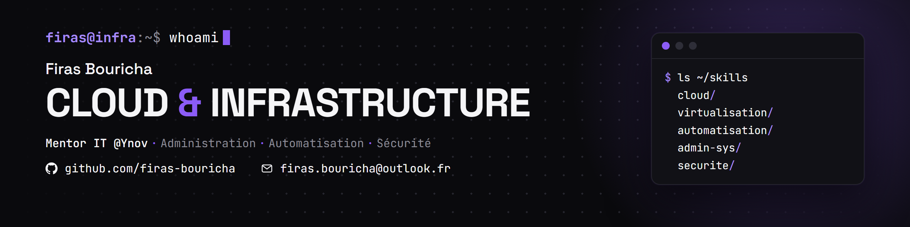

## Firas Bouricha

**Ingénieur Cloud & Infrastructure** (en apprentissage) · Mentor IT @Ynov Sophia Antipolis · Nice, France

Je conçois, j'automatise et je sécurise des infrastructures, de la VM sur Proxmox jusqu'au pipeline CI/CD.
Mastère Cloud, Sécurité & Infrastructure @Ynov (2025-2027). En parallèle, j'accompagne les étudiants en informatique comme mentor.

**Domaines :** administration systèmes · virtualisation · automatisation · cloud · sécurité

**Outils :** Linux · Proxmox · Terraform / OpenTofu · Ansible · Docker · GitHub Actions · GLPI

### Projets

| Projet | Ce que ça fait |
|---|---|
| [Home_Lab](https://github.com/firas-bouricha/Home_Lab) | Documentation et architecture de mon infrastructure auto-hébergée |
| [vm-automation-via-glpi](https://github.com/firas-bouricha/vm-automation-via-glpi) | VM as a Service : une demande GLPI crée une VM Proxmox depuis un template (Terraform + Ansible) |
| [Projet-_final_DevSecOps](https://github.com/firas-bouricha/Projet-_final_DevSecOps) | Pipeline CI/CD durci : Gitleaks, SOPS + age, Trivy, SBOM, CodeQL, déploiement conditionnel |
| [Infrastructure-as-Code-Automatisation-Multi-VMs](https://github.com/firas-bouricha/Infrastructure-as-Code-Automatisation-Multi-VMs) | OpenTofu + Cloud-Init + Ansible : provisionnement multi-VMs, pare-feu, supervision |
| [ytasty-crousty](https://github.com/firas-bouricha/ytasty-crousty) | Application fullstack conteneurisée : FastAPI, React, PostgreSQL, Docker |
| [ynov-git-avance--fr](https://github.com/firas-bouricha/ynov-git-avance--fr) | Cours, TP et mini-projets Git que j'ai créés pour les étudiants Bachelor 1 |

### Contact

[firas.bouricha@outlook.fr](mailto:firas.bouricha@outlook.fr) · [LinkedIn](https://www.linkedin.com/in/firas-bouricha/) · [Portfolio](https://firas-bouricha.github.io/firas_bouricha/)
